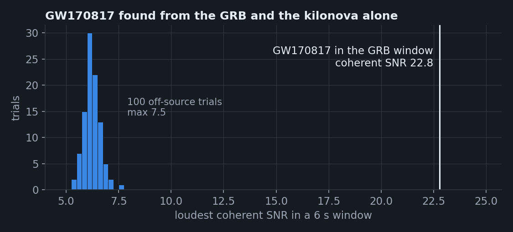

# GW170817 replayed from the GRB and the kilonova

The usual GW170817 story starts with the LIGO/Virgo alert. This example replays it **without** the GW alert:
RAVEN-KN receives only what the electromagnetic side knew on 17–18 August 2017, in the order it arrived, and
has to decide by itself when a GW search is worth running, then find the signal in the strain data.

Script: `examples/gw170817_reverse.py` (decisions and on-source search),
`examples/gw170817_reverse_offsource.py` with `examples/gw170817_reverse_cit/` (off-source background as
HTCondor jobs on CIT).

## Timeline

| Time after the GRB | What arrives | What RAVEN-KN does | Search? |
|---|---|---|---|
| 0 h (12:41 UTC) | Fermi-GBM notice 524666471: RA 176.8, Dec −39.8, 11.6° (GCN 21506, 21520) | stores the notice; no candidate yet | — |
| +10.9 h | Swope discovers SSS17a, i = 16.0 (GCN 21529), 24° from the GBM position | creates the candidate, attaches the stored GRB (within 2× its radius): window [−5, +1] s around the GRB; host NGC 4993 from NED, 40.7 Mpc (SBF, NED-D) | **held**: one epoch, no evidence yet that it is a kilonova |
| +16.9 h | first PS1 epoch (i, z, y) | re-assesses | **held**: 6.0 h after discovery, just under the 6 h needed for a second epoch |
| +21.4 h | PS1 g, r, i | re-assesses | **held**: no significant fading or reddening yet |
| +29.5 h | PS1 g, r and 2MASS J, H, Ks | g fades 1.75 ± 0.43 mag/day (4σ), r about as fast; peak M = −17.1 at NGC 4993 | **triggered** |

The photometry after discovery is the real AT2017gfo light curve (NMMA's reduced example file). No
spectrum is used: the light curve alone confirms the kilonova. The GRB alone, or the GRB and one optical
point, would not have triggered a search.

With the detector sensitivity of that day (BNS horizons H1 107, L1 218, V1 58 Mpc), `assess` expects a
network SNR of **34** at NGC 4993. The published GW170817 network SNR is 32.4.

## Search

The search request covers the 6 s GRB window [1187008879.47, 1187008885.47] at the position of SSS17a,
with the BNS chirp-mass range 1.0–1.5 M☉ (2148 templates), because the EM data do not give the chirp mass.
Coherent statistic; GWOSC GWTC-1 strain, in which the L1 glitch 1.1 s before the merger is gated.

| | Result |
|---|---|
| Loudest in the window | coherent SNR **22.8** at 1187008882.428, **1.5 ms** before GW170817's merger time |
| Chirp mass | **1.1977 M☉** (GW170817: 1.1976) |
| Per detector | H1 18.6, L1 13.3, V1 3.6 |
| Background | 100 off-source trials (6 s windows around the on-source, 20 HTCondor jobs on CIT): max **7.5**, 90th percentile 6.7, median 6.2; none as loud as the on-source |
| p-value | **< 0.01** (1/101, the floor for 100 trials) |

*Loudest coherent SNR in each of the 100 off-source 6 s windows, and in the GRB window (white line).*

The 6 s window is too short for time slides, so the background comes from off-source trials: the same
search in 6 s windows around the on-source window, at least 64 s away from it, as PyGRB does.

The coherent SNR is lower than PyGRB's 29.8 on the same data because of the gated L1 glitch: our
per-detector chi-square cuts L1 from about 24 to 13 (see
[the GW170817 targeted search](gw170817-search.md#comparison-with-pygrb)). A gate-aware chi-square is the
next fix.

## What this shows

- The GRB-first order works: the notice is stored and attached when the counterpart appears 11 h later.
- The search waits for evidence of a kilonova, and the real light curve provides it on the second night.
- Given only EM information, the targeted search finds GW170817 at the right time and chirp mass, about
  15 units above the loudest of 100 off-source trials (p < 0.01, limited by the number of trials; more
  trials would push the floor down).

Results: `examples/gw170817_reverse/` (`report.json` with the timeline, the decision and search request,
the on-source result, the 20 off-source chunks and `offsource_merged.json`).
