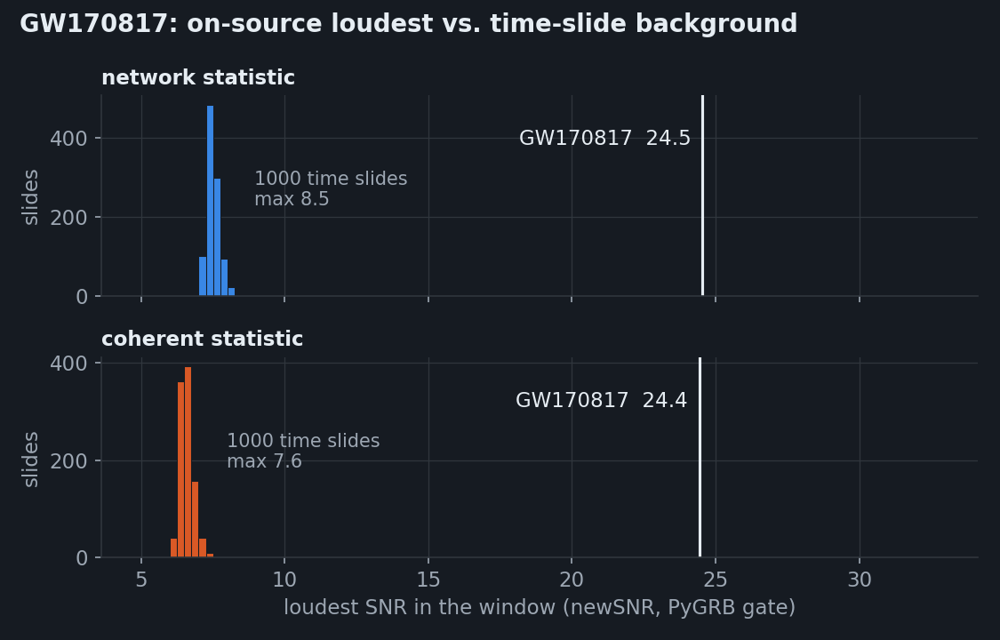

# GW170817 targeted search

GW170817 is searched for as if only its kilonova, AT2017gfo, were known: the sky position of NGC 4993, a
window around the merger, and a chirp-mass range of 1.18–1.22 M☉ (181 templates). Strain data from GWOSC.

## Light search

Network statistic, 1000 time slides, with H1 and V1 from GWOSC and L1 from the glitch-subtracted release
(LIGO-P1700349):

| Window | Network SNR | H1 / L1 / V1 | Time, chirp mass | p-value | Background max / median |
|---|---|---|---|---|---|
| containing the merger | **30.9** (published 32.4) | 18.6 / 24.5 / 3.2 | 1187008882.426, 1.1976 M☉ | < 1/1001 | 8.5 / 7.5 |
| 15 min earlier (noise only) | 7.4 | 4.0 / 5.4 / 3.1 | — | 0.62 | 8.5 / 7.5 |

On the frames with the L1 glitch still in (GWTC-1 release), the glitch 1.1 s before the merger is gated:

*Loudest event in the window containing GW170817 (white line) against the loudest event of each of 1000
time slides, for the network and coherent statistics, with PyGRB's gate on the same frames.*

GW170817 stands far above every slide with both statistics. The coherent statistic lowers the background
by about one unit (7.6 against 8.5 at most) because of its null-stream cut.

## Comparison with PyGRB

PyGRB (`pycbc_multi_inspiral` with LVK's O2 GRB170817A arguments) ran on the same frames, with the
RAVEN-KN template bank split in 4 HTCondor jobs on CIT (4 min each). Both gate the L1 glitch at the same
instant.

| | Coherent SNR | H1 / L1 / V1 | Null SNR |
|---|---|---|---|
| Light search, raw SNR | **30.4** | 18.4 / 24.0 / 3.3 | 1.0 |
| Light search, per-detector chi-square, not gate-aware (before) | 24.4 | 18.4 / 15.9 / 3.2 | 2.5 |
| Light search, gate-aware network chi-square (now the default) | raw 30.3 / reweighted **29.8** | 18.3 / 23.9 / 3.7 | 1.3 |
| PyGRB, raw / reweighted | **30.9** / 29.8 | 19.0 / 24.5 / 3.6 | 4.4 |
| PyGRB on LVK frames, raw / reweighted | **31.2** / 30.2 | 19.2 / 24.5 / 3.7 | 3.5 |

- Both find the same chirp mass (1.1976 M☉) and the same time to 1–4 ms.
- Raw SNRs agree to 2 %.
- The earlier per-detector chi-square cut the gated L1 signal from 24 to 16: the gate removes part of L1's
  chirp, which the chi-square read as a power deficit.
- The chi-square now gates the template like the data and, for the coherent statistic, reweights the
  coherent SNR with one chi-square summed over the detectors, as PyGRB: reduced chi-square 1.06, reweighted
  coherent SNR 29.8, PyGRB's value. (Last row: the 6 s GRB-window search of the
  [reverse replay](gw170817-reverse.md), 2148 templates, same frames; the slide background above was
  computed with the earlier chi-square.)

## PyGRB on LVK frames

The same PyGRB search on the collaboration's own O2 data instead of the public frames
(`examples/pygrb_gw170817_lvk/`, CIT), as a test of the [LVK data path](../targeted-search.md#data-public-or-lvk-raven_kntargeteddatasource):

1. IGWN SciToken (`htgettoken`, non-interactive with a stored vault credential).
2. DQSegDB: science flags `H1/L1:DCH-CLEAN_SCIENCE_C02:1`, `V1:ITF_SCIENCE:2` and LVK's O2 CBC veto definer
   over the 4000 s analysed. All three detectors are in science, no CAT1 time, two 2 s CAT2 stretches in H1
   (444 s and 1684 s after the merger).
3. Datafind: `H1_CLEANED_HOFT_C02`, `L1_CLEANED_HOFT_C02`, `V1O2Repro2A` (two frame files each, 16 kHz).
4. `pycbc_multi_inspiral` with LVK's O2 GRB170817A arguments, RAVEN-KN bank in 4 jobs (4–15 min each).

| | GWOSC frames | LVK frames |
|---|---|---|
| Coherent SNR, raw / reweighted | 30.9 / 29.8 | **31.2 / 30.2** |
| H1 / L1 / V1 | 19.0 / 24.5 / 3.6 | 19.2 / 24.5 / 3.7 |
| Null SNR | 4.4 | 3.5 |
| Network chi-square | 1.14 | 1.12 |
| Time, chirp mass | 1187008882.430, 1.1976 | 1187008882.430, 1.1976 |
| L1 gate | 1187008881.388 | 1187008881.388 |

The two data sets agree to 1 %; the LVK frames give slightly more in H1 (their h(t) is noise-subtracted, which may be the reason).

## Data-quality vetoes

DQSegDB queried live from CIT (O2 CBC veto definer, ±600 s around the merger): H1, L1 and V1 in science
throughout, no category-1 time, one 2 s category-2 interval 444 s after the merger, outside the on-source
window. That interval stopped a first PyGRB attempt with a longer window, which is why sub-segments are
now placed in veto-free stretches.

Results: `examples/targeted_gw170817/`, `examples/pygrb_gw170817/pygrb_loudest.json`.
