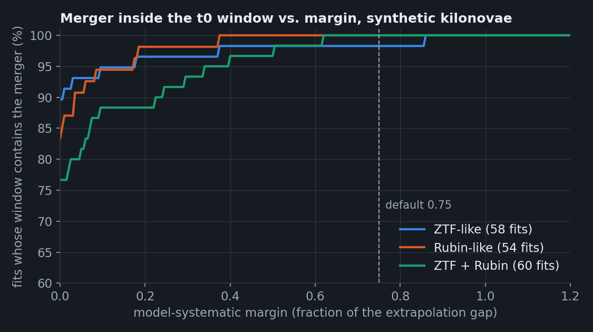
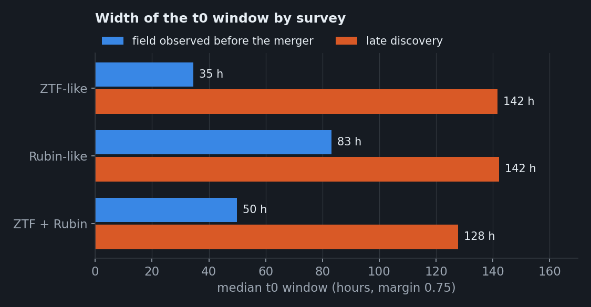

# Injection calibration of the merger-time window

Two real kilonovae are not enough to set the model-systematic margin. `examples/injections/calibrate_margin.py`
simulates kilonovae with known merger times, observes them with a survey model, fits them with NMMA, and
checks whether the window contains the merger.

## Setup

- **Kilonovae**: Bu2019lm and Ka2017 models, parameters inside their training ranges, uniform in volume, with
  a known host redshift.
- **Fits**: each kilonova fitted with both models (same model as the truth, and the other one), 512 live
  points. A third model from another radiative-transfer code, LANLTP2, is also fitted to the ZTF-like set.
- **Surveys**:

| Survey | Cadence | 5σ depth | Distance | Injections |
|---|---|---|---|---|
| ZTF-like | nightly g / r / i, 30 % of nights lost, pre-merger coverage in half the cases | 21.5 | 40–150 Mpc | 29 |
| Rubin-like | 3-day revisit, 2 of g / r / i | 24.5 | 40–300 Mpc | 27 |
| ZTF + Rubin | both, on the same field, independent phases and lost nights | each its own | 40–300 Mpc | 30 |

## How often the window contains the merger

*Fraction of Bu2019lm / Ka2017 fits whose merger lies inside the window, as a function of the margin. At 0 the
window is the bare statistical interval (cut by the bracket). One ZTF-like cross-model fit needs 0.86.*

| Fits | Statistical 90 % interval covers the merger | Margin 0.5 / 0.75 / 1.0 |
|---|---|---|
| ZTF-like, same model | 29/29 | 29/29 at all three |
| ZTF-like, other model | 23/29 | 28/29 / 28/29 / 29/29 |
| ZTF-like, LANLTP2 | 23/29 | 27/29 / 28/29 / 29/29 |
| Rubin-like, same model | 26/27 | 27/27 at all three |
| Rubin-like, other model | 19/27 | 27/27 at all three |
| ZTF + Rubin, same model | 26/30 | 30/30 at all three |
| ZTF + Rubin, other model | 20/30 | 28/30 / 30/30 / 30/30 |

Fits with the right model are well calibrated; the margin corrects for using the wrong model. The cases that
need the most margin are late discoveries without pre-merger coverage.

## How wide the window is

*Median window (margin 0.75) when the field was observed before the merger, and for late discoveries.*

- **Recency matters more than depth.** Rubin is 3 magnitudes deeper than ZTF, yet its 3-day revisit puts
  the last non-detection typically 3 days before discovery, so its windows are wider (83 h vs 35 h, though
  ZTF only reaches 150 Mpc).
- **Rubin + a nightly survey** gives 50 h: ZTF's shallower nightly limits close the gap between Rubin
  visits, and the first detection comes at +20 h instead of +41 h.
- **Late discoveries** stay at 130–140 h whatever the survey.
- A narrow window needs a deep limit hours before the merger: Rubin combined with nightly surveys
  (ZTF, ATLAS) or deep-drilling fields.

## A bug found on the way

The first ZTF-like run showed 9 of 29 photometric brackets excluding the true merger, by up to 65 h. A g
non-detection minutes before the first r detection of a red kilonova was taken as "before the merger", and
two faint kilonovae had not yet reached M = −15 after 6 h. With the same-night rule and a 0.5 d delay, all
29 brackets now contain the merger.

Reports: `examples/injections/runs_inj/report.json` (ZTF-like and LANLTP2), `runs_inj_rubin/report.json`,
`runs_inj_mixed/report.json`.
