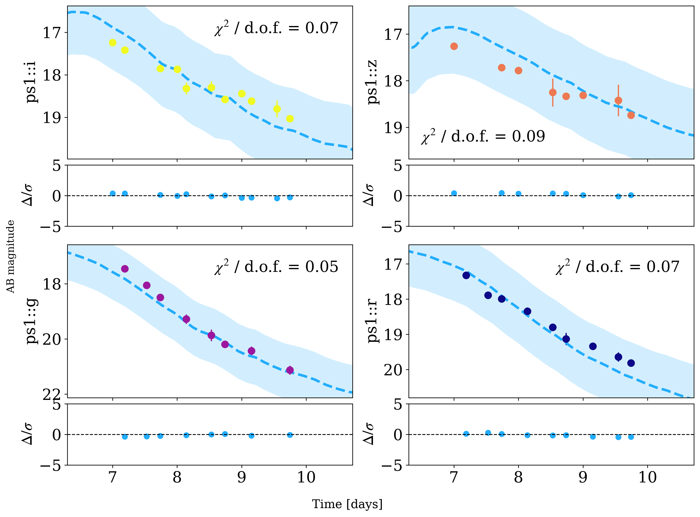
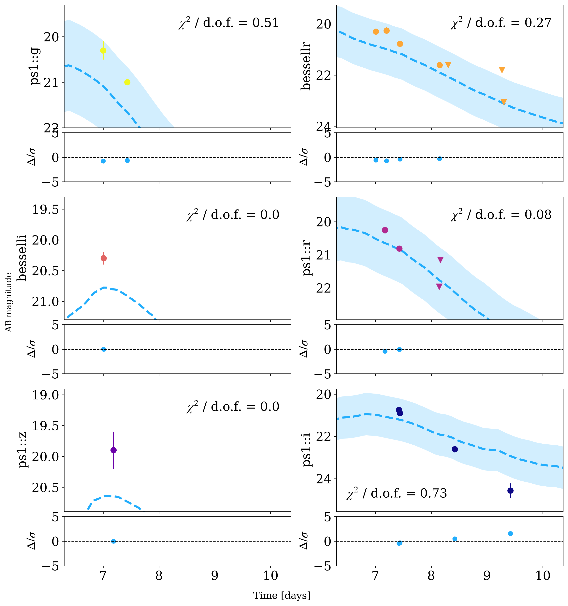

# AT2017gfo and GRB 211211A light-curve fits

Two real kilonovae with a known merger time, fitted with NMMA as if the merger time were unknown. The prompt
GW or GRB signal is hidden from the fit; only the optical photometry, the host distance (and, for
AT2017gfo, the VLBI viewing angle) are used.

| Event | Data | First point | Truth |
|---|---|---|---|
| AT2017gfo | PS1 g, r, i, z | +17 h | GW170817 |
| GRB 211211A | PS1, Bessell, 2MASS | +6.2 h | Swift-BAT / Fermi-GBM trigger, 2021-12-11T13:09:59 |

Scripts: `examples/validate_at2017gfo.py`, `examples/validate_grb211211a.py`. NMMA 1.0.2, sklearn GP
interpolation, pymultinest with 512 live points, 4–10 min per fit.

## Results

| Event | Model, data fitted | t0 median − true | 90 % interval | Truth in 90 % | Window with margin 0.75 | Truth inside |
|---|---|---|---|---|---|---|
| AT2017gfo | Bu2019lm, all data | −40.1 h | 32 h | no | 89 h | **yes** |
| AT2017gfo | Bu2019lm, first 3 d | −18.4 h | 46 h | no | 90 h | **yes** |
| AT2017gfo | Ka2017, first 3 d | −27.4 h | 87 h | no | 138 h | **yes** |
| AT2017gfo + g, r limits 3 h before merger (synthetic) | Bu2019lm, all data | −1.3 h | 9 h | yes | 19 h | **yes** |
| GRB 211211A | Bu2019lm, all data | −28.2 h | 25 h | no | 74 h | **yes** |
| GRB 211211A | Bu2019lm, first 3 d | −31.8 h | 26 h | no | 78 h | **yes** |
| GRB 211211A | Ka2017, first 3 d | −26.2 h | 38 h | no | 83 h | **yes** |

*AT2017gfo, Bu2019lm fitted on the first 3 days: best-fit light curves (dashed) with their spread, and
residuals. The time axis is days since NMMA's reference time, which is placed before the earliest
non-detection, not since the merger.*

*GRB 211211A, same model and setup.*

## What this shows

- **Without a recent non-detection, both models put the merger about a day too early**, and the statistical
  interval misses it in every case. The fits look good (χ²/dof < 0.1), so a fit's quality does not
  reveal the bias.
- The **model-systematic margin** of 0.75 recovers the merger in all fits. This is where the default comes
  from; the [injection calibration](injections.md) checks it on synthetic kilonovae.
- A **non-detection a few hours before the merger** removes the bias (−1.3 h) and gives a 19 h window.
- Bu2019lm cannot follow AT2017gfo's slow evolution: at the true merger time it is up to ~1 mag too bright in
  i and z at 1.5–2.5 d and ~1 mag too faint after 6 d, so the fit makes the source older. Fitting only the
  first 3 days halves the bias on AT2017gfo, but not on GRB 211211A, whose early optical light includes
  afterglow.
- The kilonova-only distance is unreliable: 165 Mpc (90 %: 115–274) for GRB 211211A, at 357 Mpc. The
  search decision must rest on a host redshift.

Reports: `examples/validation/report*.json`, `examples/validation_grb211211a/report*.json`.
