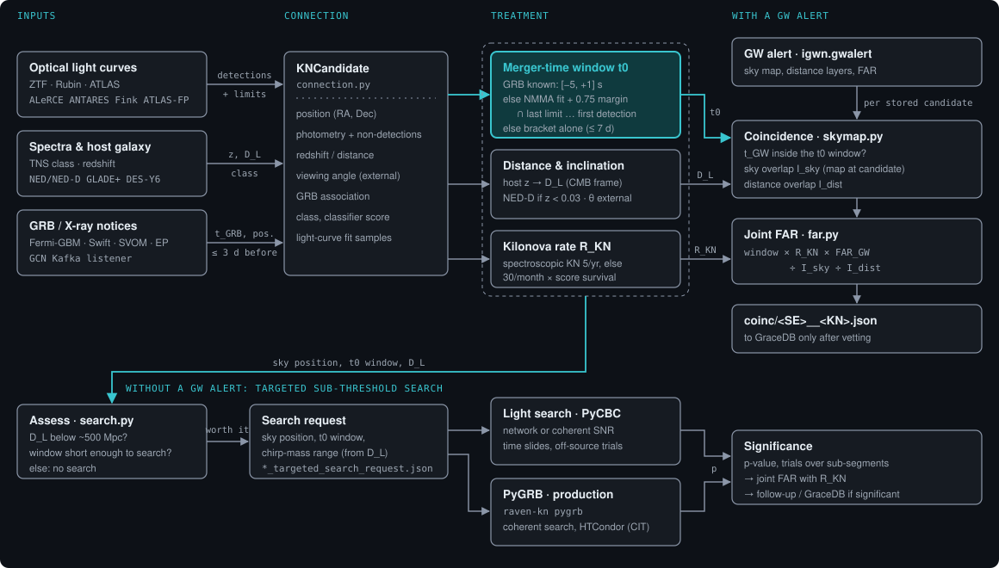

# RAVEN-KN

RAVEN-KN turns a **kilonova candidate** into what a gravitational-wave (GW) search needs: a sky position,
a merger-time window, a distance and an inclination. With these it either

- checks the candidate against **existing GW alerts** and computes a joint false-alarm rate (FAR), or
- decides whether a **targeted search of archived strain data** is worth running, and prepares or runs it.

It follows the layout of LVK's RAVEN (`ligo.raven` 3.3), which does the same for gamma-ray bursts, so that it
can later be merged into it or called from gwcelery.



## Where to start

<div class="grid cards" markdown>

- **[Workflow](workflow.md)**: how a candidate goes from survey alerts to a coincidence or a search, step
  by step.
- **[Examples](examples/index.md)**: results on real events (AT2017gfo, GRB 211211A, GW170817,
  S250818k) and on synthetic kilonovae.
- **[GW170817 without the GW alert](examples/gw170817-reverse.md)**: the whole loop in reverse. From the
  Fermi-GBM notice and the AT2017gfo light curve alone, the search is triggered on the second night and
  finds GW170817 at coherent SNR 30.3, 2 ms from the merger time (p < 0.01 from 100 off-source trials).

</div>

## Install

```bash
git clone https://github.com/danielsentenac/raven-kn.git && cd raven-kn
python -m venv --system-site-packages .venv && .venv/bin/pip install -e .[test]
.venv/bin/python -m pytest -q -p no:anyio tests
```

Optional pieces:

| Piece | Needed for | Notes |
|---|---|---|
| [NMMA](https://github.com/nuclear-multimessenger-astronomy/nmma) 1.0.x | kilonova light-curve fits | in its own conda env, passed with `--executable` |
| PyCBC, LALSuite | targeted GW search | the IGWN conda env on LIGO clusters has both |
| `gcn-kafka` + GCN client credentials | real-time listener | from [gcn.nasa.gov](https://gcn.nasa.gov) |
| IGWN SciToken | DQSegDB veto queries | `htgettoken -a vault.ligo.org -i igwn` |
| ATLAS token, TNS bot, IPAC ZFPS account | ATLAS and ZTF forced photometry, TNS classifications | personal credentials |

## Quick try

```bash
.venv/bin/python examples/make_examples.py
.venv/bin/raven-kn assess examples/gw170817_like.json --out examples/out --ranges H1=150,L1=160,V1=55
```

`assess` writes the decision (search or not), a 3D sky map of the candidate, distance and inclination
samples and, if a search is worth it, a targeted-search request.

## Licence and credits

GPL-3.0-or-later, like LVK RAVEN and NMMA. The kilonova model priors are adapted from NMMA's prior files, and
the AT2017gfo and GRB 211211A light curves are NMMA's example files (v1.0.2). The merger-time method follows
Jamsin et al., [arXiv:2610.28775](https://arxiv.org/abs/2610.28775).
