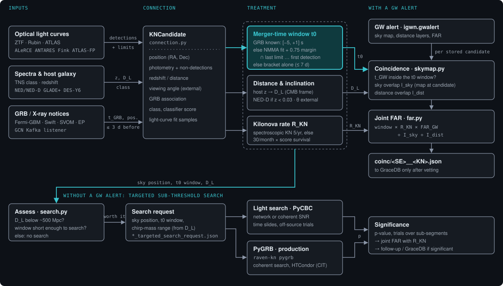

# Workflow overview



RAVEN-KN works in the opposite direction to most multi-messenger pipelines: it starts from the
**electromagnetic counterpart** and asks what it implies for the GW data.

```
kilonova candidate → is a GW search worth it? → merger-time window, sky position, distance, inclination
                   → coincidence with existing GW alerts (joint FAR) and/or targeted search of archived strain
```

## 1. Inputs

| Input | Gives | Sources |
|---|---|---|
| Optical light curves | detections, and non-detections with their depth | ZTF, Rubin and ATLAS through ALeRCE, ANTARES, Fink and ATLAS forced photometry |
| Spectra and host galaxy | classification, redshift, distance | TNS, NED / NED-D, GLADE+, DES Y6 |
| GRB and X-ray notices | prompt-emission time and position | Fermi-GBM, Swift-BAT, SVOM-ECLAIRs, Einstein Probe through GCN Kafka |
| Viewing angle | inclination prior | external: afterglow modelling, VLBI, light-curve fits |

## 2. Connection: the kilonova candidate

All inputs are merged into one `KNCandidate` (`raven_kn.connection`): position, photometry including
non-detections, redshift and distance, viewing angle, GRB association, classification and classifier score,
and the samples of a light-curve fit. Photometry from several surveys is merged without duplicates, so
the latest deep non-detection can come from any of them.

The candidate can be exported as a GraceDB external-event dictionary that LVK RAVEN accepts directly.

## 3. Treatment

Three quantities are derived from the candidate. They are explained in detail on their own pages.

- **[Merger-time window t0](t0-window.md)**: the stretch of time in which the merger happened.
  Everything downstream depends on it. A GRB gives it to seconds; otherwise it comes from a kilonova
  light-curve fit, widened by a model-systematic margin, and cut by the last non-detection before the
  first detection.
- **[Distance and inclination](coincidence.md#distance-and-inclination)**: from the host redshift (best),
  a redshift-independent host distance, or the light-curve fit (least reliable); the viewing angle from
  external measurements.
- **[Kilonova rate](coincidence.md#kilonova-candidate-rate)** R_KN: how often candidates like this one
  appear by chance, the analogue of RAVEN's GRB rate.

## 4. Decision: is a GW search worth it?

`raven-kn assess` computes the expected network SNR of a binary neutron star at the candidate's distance,
at its sky position, over the window (detector antenna patterns, Earth rotation, duty cycle). It triggers
a targeted search when the expected SNR can reach the threshold (default 6, probability ≥ 0.1), and never
beyond 500 Mpc. A candidate at z = 0.15 (737 Mpc) is rejected; an AT2017gfo-like one at 45 Mpc gives an
expected SNR of about 50.

## 5a. With a GW alert: coincidence and joint FAR

When an LVK alert arrives whose merger time falls inside a stored candidate's window, RAVEN-KN computes a
joint FAR from the window length, the kilonova rate, the GW FAR, and the overlap of the two sky maps and
distance distributions. See [Distance, rate and joint FAR](coincidence.md).

## 5b. Without a GW alert: targeted search

The window, sky position and chirp-mass range (from the distance) become a search request. RAVEN-KN runs a
light PyCBC search itself, or writes a configuration for PyGRB, LVK's production targeted search. See
[Targeted GW search](targeted-search.md).

## 6. Real time

The [listener](listener.md) runs branch 5a automatically for every GW alert and every stored candidate,
and attaches GRB notices to candidates as they arrive.
